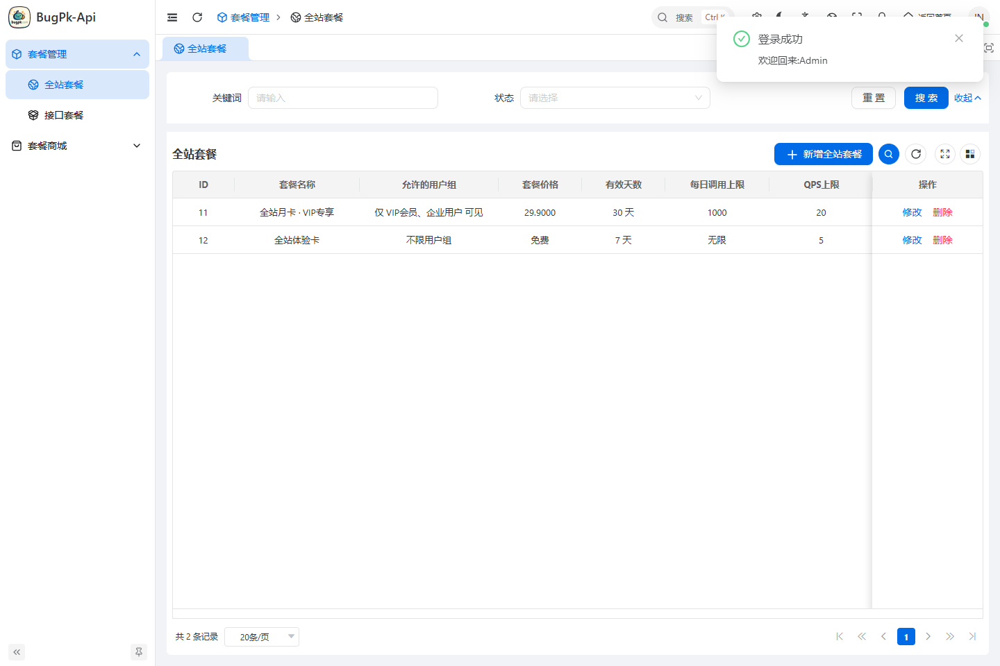
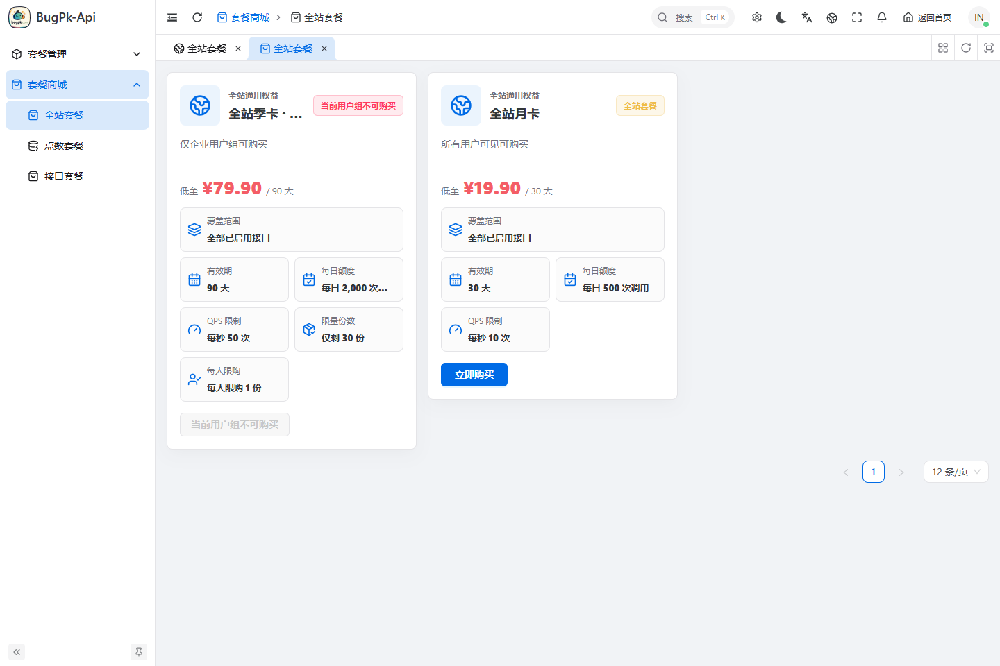
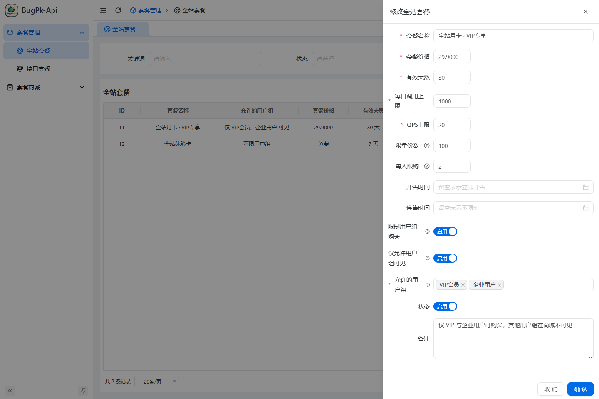

# BugPk-Api Documentation

[简体中文](README.md) · **English**

 This project is shared in the [LINUX DO](https://linux.do) community, where deployment and usage questions are welcome.

BugPk-Api is an open-source **open API service platform**: a backend gateway with billing, an admin console, a customer-facing site, and this documentation.

| Repository | Description | License |
| --- | --- | --- |
| [bugpkapi-new-go](https://github.com/jiuhunwl/bugpkapi-new-go) | Backend service: Go + Hertz + MySQL + Redis | AGPL-3.0 |
| [bugpkapi-new-vue](https://github.com/jiuhunwl/bugpkapi-new-vue) | Frontend: Vue 3 + Vben Admin + Vite | MIT |
| **bugpkapi-new-docs** (this repository) | Documentation, architecture notes and deployment guide | CC BY 4.0 |

## Screenshots

The screenshots below were taken from a running instance and are full-page captures at 1440×960.

*Admin console: plan list, with visibility and purchase restricted by user group*

*Customer site: plan store, plans unavailable to a user group are shown as non-purchasable*

*Admin console: plan configuration, restricting which user groups can see and buy*

## Where to Start

- New to the project: read the [Architecture Overview](./docs/architecture_EN.md).
- Want to get it running: read the [Deployment Guide](./docs/deployment_EN.md).
- Changing configuration or adding a payment channel: read the [Configuration Reference](./docs/configuration_EN.md).
- Contributing code: check each code repository's README, `CONTRIBUTING` (if present) and `SECURITY.md` first.

## Capabilities

| Module | Capabilities |
| --- | --- |
| Open API gateway | Single entry point at `/api/{apiCode}`, forwards to upstream per API configuration, with parameter validation, caching and rate limiting |
| APIs and billing | API management, QPS limits, plans (site-wide / per-API / credits), per-call billing, balance and ledger |
| Payments | Alipay, WeChat Pay and pluggable channels; idempotent callbacks, order reconciliation, replay protection for notifications |
| Users and permissions | RBAC roles / menus / button permissions, sign-up and password recovery, multi-scenario captcha |
| Risk control and audit | Call log fingerprinting, risk snapshots, account bans, operation logs, IP geolocation |
| Content operations | Site and branding configuration, SEO, announcements, ad slots, partner links, donations, agreement templates |
| Analytics | Incremental call log rollups (minute / hour / day); dashboards decoupled from raw logs |
| Tickets | Customer tickets and messages, admin handling flow, attachment policy |

## Minimal Path

1. Prepare a Linux server with MySQL 8 and Redis 6+ installed.
2. Create an empty database and import the initialization SQL from `sql/full` in the backend repository.
3. Set the database password, `JWT_SECRET`, `PAYMENT_CONFIG_SECRET` and `INITIAL_ADMIN_PASSWORD` through environment variables, then start the backend.
4. Build the frontend artifacts, serve them with Nginx on the same origin, and reverse proxy `/system-api` and `/api` to the backend.
5. Sign in to the admin console as `admin` with the initialization password, then configure the site, APIs, plans and payments.

See the [Deployment Guide](./docs/deployment_EN.md) for exact commands and reverse proxy examples.

## Security

The initialization SQL contains no user seeds; the first administrator is created from the deployer's environment variables, and all production secrets are injected through environment variables. See `SECURITY.md` in each code repository for how to report vulnerabilities.

## License

Documentation is licensed under CC BY 4.0; code licenses follow each repository's `LICENSE` (AGPL-3.0 for the backend, MIT for the frontend).